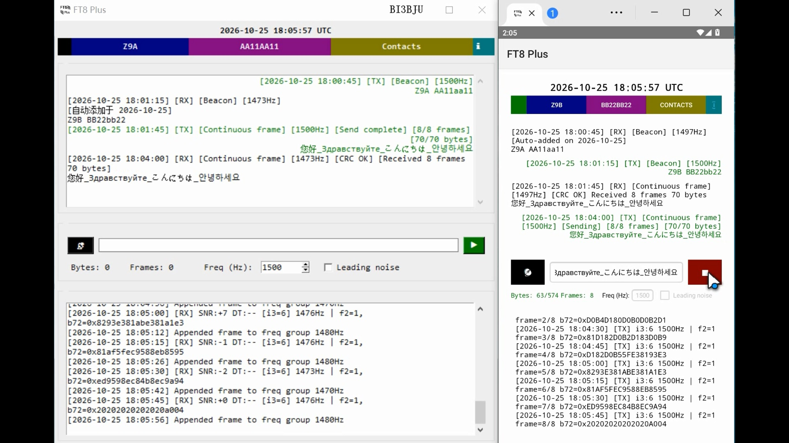

# FT8 Plus for Android Protocol Demo

[](LICENSE.txt)
[](#)
[](#)

Copyright (C) 2026 BI3BJU

Android native implementation of the FT8 Plus 1.0 protocol demo. It is based on the
FT8 Plus desktop/Python project and uses a Java UI plus a JNI bridge to a C
`ft8_lib` decoder/encoder.

- Upstream protocol demo: https://github.com/BI3BJU/FT8_Plus_Desktop
- Email: guerilla1949@gmail.com

| Main |
| :---: |
|  |

## Features

- Real-time FT8 receive: 12 kHz mono `AudioRecord`, 15 s slots, JNI decoder.
  A slot scheduler triggers decoding after each slot; decoded DT is tracked with
  an EMA and a jump-snap rule to compensate audio input latency.
- Transparent single-frame TX: i3=6, f2=0, up to 9 UTF-8 bytes,
  `0x20` padding, no CRC/EOT.
- Transparent continuous-frame TX: i3=6, f2=1, 9 bytes per frame,
  CRC8 + EOT `0x04`, up to 64 frames / 574 bytes. RX groups frames by
  frequency within +/-10 Hz and reassembles them with slot tracking;
  missing slots are shown as `[frame missing]`.
- Free text TX/RX: i3=0, up to 13 chars, Base42 charset.
- Beacon: every 16 slots (240 s), sends a 13-char Base42 location message
  containing callsign + 8-char Maidenhead grid. Requires a valid callsign and
  8-char grid; skipped when the TX input field is not empty. Received beacon
  rows show `CALL GRID`; tapping such a row opens the map.
- Contacts: max 100 contacts, remark max 32 UTF-8 bytes. Received source
  callsigns are auto-saved. Entries involving the local callsign are
  highlighted and underlined. Contact remarks are shown in history.
- History/status logs: `history.txt` in JSON Lines, `status.txt` in plain text,
  each trimmed to the latest 1000 lines. On-screen history holds up to 1000 entries.
- Optional preamble noise for VOX: 0.5 s white noise + 0.5 s silence before
  each FT8 frame.
- Half-duplex operation: RX pauses during TX and resumes afterwards; beacon
  runs on its own worker thread.
- NTP sync at startup with multiple servers and retry; only the app's internal
  UTC offset is adjusted, system time is not modified.
- Map fallback: `geo:` URI first, Bing Maps fallback when no map app handles it.

## Current limitations

- The message-processing layer in this Android code handles i3=0 free text,
  i3=6 transparent frames, and location beacons. i3=1 standard FT8 messages
  are currently skipped by `processDecodedMessages()`. Standard FT8 QSO TX
  is not implemented.
- No CAT / PTT / serial / frequency control. Audio only via the system default
  input and output devices.
- For amateur radio FT8 experimentation only. Comply with local regulations,
  licensed frequencies, power limits, and callsign rules.

## Requirements

- Android Studio with Android SDK.
- The project includes a Gradle Wrapper (workspace shows Gradle 8.10).
- Android NDK and CMake for `ft8_jni` / `ft8_lib`.
- Real device recommended for RX/TX. Emulator microphone may be silent.
- Permissions:
  - `RECORD_AUDIO` for RX.
  - `WRITE_EXTERNAL_STORAGE` on Android 10 and below.
  - `MANAGE_EXTERNAL_STORAGE` on Android 11+ for direct access to
    `Documents/FT8 Plus/`.
  - `ACCESS_FINE_LOCATION` / `ACCESS_COARSE_LOCATION` optional, for deriving
    the grid from system location.

## Build and run

Windows:

```bash
gradlew.bat assembleDebug
```

macOS / Linux:

```bash
./gradlew assembleDebug
```

Or open the project in Android Studio and use Run.

APK is normally under `app/build/outputs/apk/debug/`. In this workspace the
intermediate APK is also present at
`app/build/intermediates/apk/debug/app-debug.apk`.

Install:

```bash
adb install -r app/build/outputs/apk/debug/app-debug.apk
```

If the outputs path differs, use Android Studio: Build > Build APK(s).

## Usage

1. Grant microphone permission. On Android 11+ grant All files access if prompted.
2. Set your callsign. Format: 3-7 chars, 1-2 prefix + digit + 0-4 letters,
   prefix must contain a letter.
3. Set an 8-char Maidenhead grid if you want beacon or map features.
4. RX starts after `RECORD_AUDIO` is granted. The UTC clock and status area
   show NTP/recording state.
5. Type a message in the TX field.
   - If it matches free-text rules (up to 13 chars, Base42 charset), it is sent
     as i3=0.
   - Otherwise it is sent as transparent single-frame or continuous-frame data.
   - Byte and frame counters show the computed size.
6. Press Transmit; press Stop to cancel. RX resumes after TX.
7. Beacon button toggles automatic beacon. Beacon requires valid callsign and
   grid, and sends only when the TX input is empty.
8. Long-press input, status, or history for copy/clear menus.
9. Tap a beacon row containing a grid to open the map.

## Protocol and fixed parameters

- Slot period: 15 s.
- Sample rate: 12000 Hz, mono PCM 16-bit.
- Symbol rate 6.25; HPS=4; BPT=2.
- 0.04 s per hop; 0.160 s per symbol; 375 hops per slot; 750 hops for two periods.
- TX frequency 300-3000 Hz; default 1500 Hz; step 6.25 Hz.
- Max raw data 574 bytes; max 64 frames.
- Frequency grouping tolerance +/-10 Hz.
- Free text: i3=0, n3=0, up to 13 chars, Base42 charset.
- Transparent single frame: i3=6, f2=0, up to 9 UTF-8 bytes, `0x20` padding,
  no CRC/EOT.
- Transparent continuous frames: i3=6, f2=1, 9 bytes per frame, CRC8 + EOT `0x04`.
- Beacon: 13-char Base42 location payload. Callsign is base36 in 37 bits,
  8-char Maidenhead grid is 31 bits; total 68-bit payload.
- Merge/timeout: receive buffer timeout scales with the received slot span;
  the code contains a base delay constant of 60 s.

## Persistent files

Directory: `Documents/FT8 Plus/`

- `config.txt`: JSON with `callsign`, `grid`, `tx_freq`, `preamble_noise`.
- `contact.txt`: one contact per line as `callsign,remark`.
- `history.txt`: JSON Lines history entries.
- `status.txt`: plain-text status log.

Retention:
- History log: latest 100 lines.
- Status log: latest 100 lines.
- Contacts: max 100, remark max 32 UTF-8 bytes.

## Project layout

- `app/src/main/java/com/bi3bju/ft8_plus/MainActivity.java`
  UI, audio capture/playback, slot scheduler, NTP, persistence, protocol framing,
  location codec, contacts, history/status logs.
- `app/src/main/res/layout/activity_main.xml`
  Main screen layout.
- `app/src/main/res/values/strings.xml`
  English resources.
- `app/src/main/res/values-zh-rCN/strings.xml`
  Chinese resources.
- `app/src/main/cpp/jni/ft8_jni.cpp`
  JNI bridge.
- `app/src/main/cpp/ft8_lib/`
  C decoder/encoder library (`common`, `fft`, `ft8`).
- `app/src/main/cpp/CMakeLists.txt`
  Native build definition.
- `gradle/wrapper/`
  Gradle Wrapper.

## Notes

- NTP sync does not change system time; it only updates the app's internal offset.
- Audio latency compensation uses decoded DT with EMA and a hard jump threshold.
- Direct File API is used for persistence because MediaStore writes were
  unreliable on some MIUI builds. Android 11+ therefore needs All files access.
- This project is for demonstration and amateur radio experimentation.
  Use legal power, frequencies, and callsigns.

## License

GPL-3.0. See `LICENSE.txt`.
